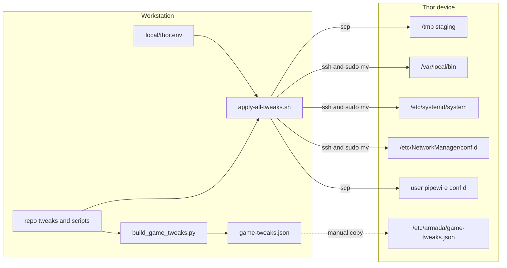
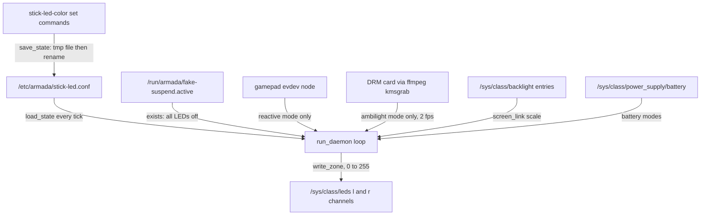
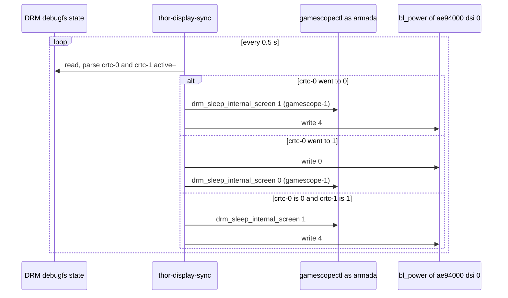
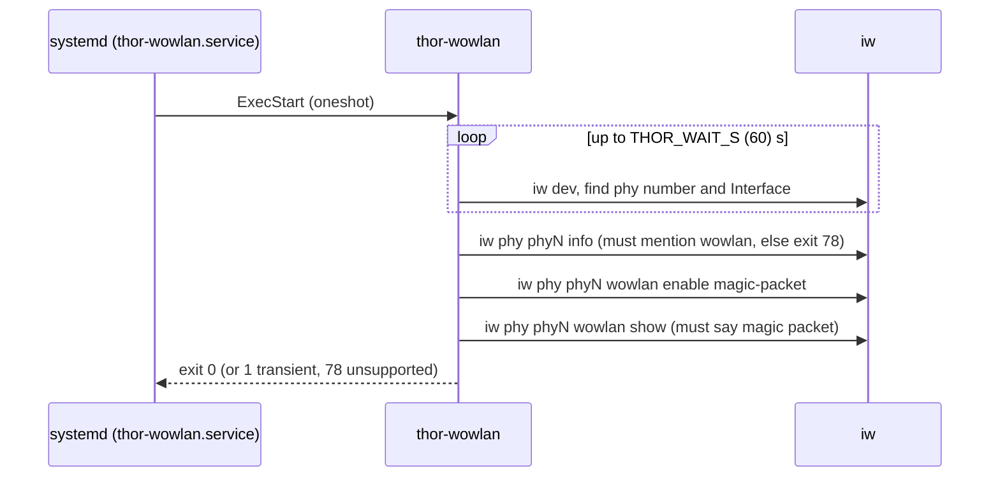
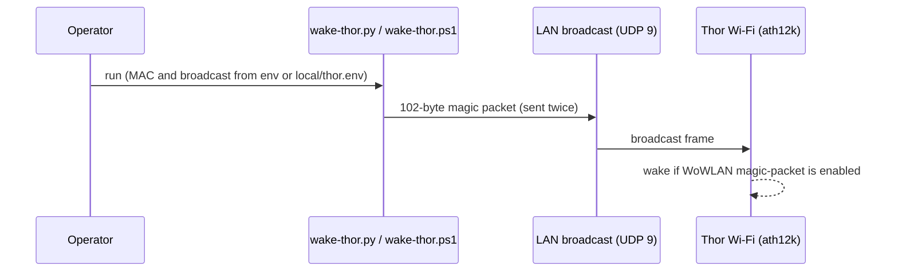
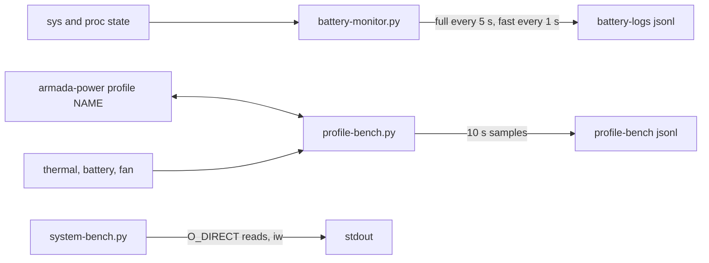

# 03 - Data flow

## Deploy and status (workstation to device)

## LED daemon (device)

## Display sleep sync (device)

## WoWLAN enable (device)

## Wake from the workstation

## Telemetry and benchmarks (device)

